# AI-Driven Smart Welfare Resource Management System — Master Production Blueprint & Build Protocol

> **System Title:** AI-Driven Smart Welfare Resource Management System for Orphanages and Old Age Homes Using Machine Learning and Deep Learning  
> **Status:** Production-Ready Blueprint & Operational Specification  
> **Target Stack:** Next.js 16 (App Router) + TypeScript + Tailwind CSS + Supabase (Auth, PostgreSQL, Storage, RLS)

---

## 1. Project Overview & Architectural Blueprint

This system is an enterprise-grade welfare management platform designed for public-service institutions, care homes, NGOs, physicians, donors, and government ministries. It bridges real-time resource logistics with machine learning demand forecasting and clinical health-risk triage for vulnerable populations.

### Core Architectural Layers
1. **Presentation & Application Layer:** Next.js 16 App Router with React 19, modular accessible components, role-specific operational dashboards, and an official bilingual government landing page.
2. **Identity & Authorization Layer:** Supabase Auth with cookie-based SSR sessions, PostgreSQL Row Level Security (RLS) across 12 relational tables, and security definer role functions.
3. **Data & Storage Layer:** Normalized PostgreSQL tables (`institutions`, `profiles`, `institution_memberships`, `beneficiaries`, `medical_records`, `resource_records`, `inventory_items`, `donations`, `alerts`, `predictions`, `audit_logs`, `notifications`).
4. **AI & Clinical Decision Support Layer:** Provider-agnostic adapter architecture supporting deterministic local baseline simulations (`DemoAIAdapter`) and external Python ML microservices (`RemoteAIAdapter` via FastAPI).

---

## 2. Canonical System Modules Matrix (Total: 15 Core Modules)

The platform is partitioned into **15 discrete, production-ready domain modules**:

| # | Module Name | Route / Path | Primary Stakeholders | Core Purpose & Technical Functionality |
|---|---|---|---|---|
| **1** | **Official Government Portal** | `/` | All Citizens / Public | Bilingual public service landing page compliant with national branding (Ashoka Emblem, Digital India, Ministry of Women & Child Development). |
| **2** | **Authentication & RBAC** | `/login`, `/register` | All 7 Roles | Supabase Auth with cookie-based SSR sessions, 1-click test credentials, and automated profile provisioning (`handle_new_user`). |
| **3** | **Institutions Directory** | `/institutions` | Government, Care Home | Care home accreditation registry, dynamic bed capacity progress bars, occupancy rate alerts, and official state verification workflow. |
| **4** | **Beneficiaries Registry** | `/beneficiaries` | Institution Staff, Admin | Privacy-preserving resident roster (`BEN-CH-...`, `BEN-ELD-...`), admission/discharge workflows, bed occupancy auto-sync, and safe CSV export. |
| **5** | **Resource & Stock Ledger** | `/resources` | Institution Staff, NGO | Multi-category inventory ledger (Food grains, clothing, essential medicines) with low-stock threshold triggers and instant restock actions. |
| **6** | **Donation Management** | `/donations` | Donors, NGOs, Admin | Monetary and in-kind donation logging, verified receipt generation, transparent allocation, and lifecycle stepper (`pledged` $\to$ `utilized`). |
| **7** | **Doctor Vault & Medical Vitals** | `/health` | **Physicians Only** | Clinical measurement queue (systolic/diastolic BP, fasting blood glucose, BMI, medications) strictly isolated under PostgreSQL RLS. |
| **8** | **AI Demand Forecasting** | `/resources` | Government, Care Home | Machine Learning regression (XGBoost / Random Forest) projecting next-month food (kg), clothing, medicine, and operational budget (₹) quotas. |
| **9** | **Deep Learning Health Triage** | `/health` | Physicians Only | Multi-factor clinical triage heuristics; computes 0–100 Welfare Priority Score; dispatches instant alert when Priority Score $\ge 70$. |
| **10** | **AI Predictions & SHAP Workspace** | `/predictions` | Staff, Researchers | Interactive simulation lab with model execution triggers, domain filtering, and expandable SHAP factor contribution drawers. |
| **11** | **Research Evaluation Lab** | `/research` | Researchers, Admin | Empirical algorithm comparison (Linear Regression vs Random Forest vs XGBoost) enforcing strict academic integrity (no fabricated metrics). |
| **12** | **Reports & Document Export** | `/reports` | All Stakeholders | Structured document generation engine exporting audit summaries, inventory ledgers, and safe resident rosters to CSV format. |
| **13** | **Alerts & Notification Desk** | `/notifications` | All Stakeholders | Real-time notification center for critical stock shortages, clinical vitals spikes, and state accreditation reviews with acknowledgment workflows. |
| **14** | **System & Priority Settings** | `/settings` | Admin, Doctors | Customization of Priority Score formula weights (age vulnerability, DL risk, chronic diseases, medication count) and alert thresholds. |
| **15** | **PostgreSQL Audit Logging** | Database Triggers | Admin, Auditors | Tamper-proof, immutable audit ledger tracking actor identity, event timestamp, action type, IP address, and JSON diffs across all entities. |

---

## 3. Phased Implementation Roadmap & Deliverables (Total: 8 Phases)

```mermaid
flowchart LR
    P0["Phase 0<br/>Foundation"] --> P1["Phase 1<br/>Identity & RBAC"]
    P1 --> P2["Phase 2<br/>Care Homes & Residents"]
    P2 --> P3["Phase 3<br/>Stock & Donations"]
    P3 --> P4["Phase 4<br/>AI Demand Forecasting"]
    P4 --> P5["Phase 5<br/>Clinical DL Triage"]
    P5 --> P6["Phase 6<br/>Reports & Alerts"]
    P6 --> P7["Phase 7<br/>E2E Hardening"]

    classDef done fill:#dcfce7,stroke:#16a34a,stroke-width:2px;
    classDef next fill:#e0f2fe,stroke:#0284c7,stroke-width:2px;
    class P0,P1,P2,P3,P4,P5 done;
    class P6 next;
```



### Phase 0: Build Foundation & Runtime Stability (COMPLETED & VERIFIED)
- **Goal:** Establish zero-network build resilience and stable compilation environment.
- **Deliverables:** Next.js 16 App Router configuration, Webpack compiler fallback for Windows IPC stability, decoupled font assets, and static bundle optimization across all routes.
- **Acceptance Criteria:** `npm run build` exits code 0 with zero static generation errors.

### Phase 1: Identity, Supabase Auth & 7-Role RBAC (COMPLETED & VERIFIED)
- **Goal:** Provision user authentication and role-based access control backed by live Supabase.
- **Deliverables:**
  - Supabase Auth integration supporting signup, login, session cookies, and password recovery.
  - Granular Row Level Security (RLS) policies on `profiles` and `institutions`.
  - 1-Click quick-fill login helpers for key roles (including Donor account `ng829353@gmail.com`).
  - Automatic whitespace normalization and password synchronization.
- **Acceptance Criteria:** Verified live authentication against Supabase Auth with zero authorization bypasses.

### Phase 2: Core Institutional & Beneficiary Management (COMPLETED & VERIFIED)
- **Goal:** Implement the primary operational entities: Care Homes and Residents.
- **Deliverables:**
  - `/institutions`: Facility directory, bed capacity progress bars, occupancy rate calculations, and Government State Verification actions (`verified` / `rejected`).
  - `/beneficiaries`: Privacy-preserving resident registry, admission modal with compliant `BEN-CH-...` / `BEN-ELD-...` generator, and safe CSV export.
  - Automatic bed capacity synchronization: Admitting a resident increments occupancy; transferring or discharging decrements occupancy.
- **Acceptance Criteria:** Real-time database persistence to Supabase `institutions` and `beneficiaries` tables.

### Phase 3: Logistics, Resources & Donation Tracking (COMPLETED & VERIFIED)
- **Goal:** Deliver real-time inventory management and transparent donor contribution reconciliation.
- **Deliverables:**
  - `/resources`: Multi-category inventory ledger (Food Grains, Clothing, Medicines, Hygiene) with dual Table Ledger & Grid views, high contrast typography, and instant CSV export.
  - Automated low-stock warning alerts triggered when stock falls below reorder thresholds.
  - `/donations`: Verified contribution logging with unique receipt numbers, allocation tracking, and lifecycle status transitions (`pledged` $\to$ `received` $\to$ `allocated` $\to$ `utilized`).
- **Acceptance Criteria:** Restocking items updates current stock and clears active inventory deficit alerts.

### Phase 4: Machine Learning Demand Forecasting Engine (COMPLETED & VERIFIED)
- **Goal:** Deliver proactive resource procurement forecasts driven by resident census and seasonal data.
- **Deliverables:**
  - Dual-mode AI adapter: deterministic local heuristic baseline (`DemoAIAdapter`) and external Python ML microservice (`RemoteAIAdapter` via FastAPI).
  - Regression inference predicting next-month Food (kg), Clothing (units), Medicine (units), and Operational Budget (₹).
  - `/predictions`: Interactive forecast simulation modal (`SimulateForecastModal`) with census sliders, seasonal flags, Model Architecture Registry, and CSV export.
  - Prediction audit logging into the immutable `predictions` table.
- **Acceptance Criteria:** Graceful fallback to local heuristic if remote microservice is offline, with explicit synthetic labeling.

### Phase 5: Deep Learning Clinical Health-Risk Triage & Medical Vault (COMPLETED & VERIFIED)
- **Goal:** Protect vulnerable resident health through early clinical prioritization.
- **Deliverables:**
  - `/health`: Doctor-only clinical review vault with vitals logging modal (`RecordVitalsModal`) for systolic/diastolic BP, fasting blood sugar, weight, height, and live BMI computation.
  - 0–100 Composite Welfare Priority Score calculation:
    $$P = w_a A_{norm} + w_r R_{norm} + w_c C_{norm} + w_m M_{norm}$$
  - Automated high-severity alert dispatch whenever Priority Score $P \ge 70$.
  - SHAP factor contribution explainability waterfall breakdown.
- **Acceptance Criteria:** Strict RLS enforcement preventing non-physicians from reading sensitive medical vitals.

### Phase 6: Operational Dashboards, Document Reporting & Alerts (NEXT PHASE)
- **Goal:** Provide tailored operational views for all 7 stakeholders and structured document exports.
- **Deliverables:**
  - Role-specific dashboard layouts in `role-dashboard.tsx`.
  - Dynamic CSV reporting engine in `/reports` with physician-only clinical export protection.
  - Centralized notification center in `/notifications` with alert status filters and batch acknowledgments.
- **Acceptance Criteria:** Each role views only jurisdiction-authorized data upon login.

### Phase 7: Comprehensive Hardening, Academic Verification & Review
- **Goal:** Ensure 100% production readiness, security compliance, and research integrity.
- **Deliverables:**
  - Automated end-to-end verification suite `scripts/verify-system.mjs` (61 / 61 tests passing).
  - Strict TypeScript check (`npx tsc --noEmit`) with 0 errors.
  - Academic integrity compliance: no fabricated accuracy, MAE, RMSE, or $R^2$ metrics (clearly marked `TBD` or `XX.XX`).
- **Acceptance Criteria:** Complete test pass rate, verified reproducible setup, and complete documentation.

---

## 4. Stakeholder Roles & Access Control Matrix (7 Roles)

| Role | Operational Scope | Beneficiary Access | Medical Vitals | Resource & Stock | AI Predictions | Document Exports |
| :--- | :--- | :--- | :--- | :--- | :--- | :--- |
| **Government** | State/District accreditation & inspection | Full roster (anonymized) | **Denied** (Privacy-safe) | State-wide demand overview | View forecasts; manage alerts | Full compliance reports |
| **Institution** | Care home superintendent (daily operations) | Full profiles for own residents | Basic administrative data | Full CRUD on own stock; restock triggers | Run forecasts; view shortages | Care home roster & stock CSV |
| **Doctor** | Clinical triage & geriatric review | Clinical review queue | **Full Access** (Doctor Vault) | Review medicine inventory | Run health triage; review SHAP | Doctor clinical summaries |
| **Donor** | Verified philanthropic contributions | Anonymized impact metrics | **Denied** | View verified care home needs | General transparent utilization | Donation receipts & impact audit |
| **NGO** | Program allocations & outreach campaigns | Enrolled residents in assigned homes | **Denied** | View supply deficits & gaps | View demand projections | Program impact audits |
| **Volunteer** | Field logistics & supply deliveries | Minimal assigned task data | **Denied** | View delivery requisitions | View task alerts | Task completion reports |
| **Admin** | System-wide platform governance | Full administrative access | Audit access | Full administrative access | Model registry & weights tuning | Full system backup export |

---

## 5. Production Environment & Deployment Runbook

### 5.1 Environment Configuration (`.env.local`)
```ini
# Supabase Cloud Project Configuration
NEXT_PUBLIC_SUPABASE_URL=https://your-project-id.supabase.co
NEXT_PUBLIC_SUPABASE_ANON_KEY=eyJhbGciOiJIUzI1NiIsInR5cCI6IkpXVCJ9...

# Optional Server-Only Secret (NEVER expose to client bundles)
SUPABASE_SERVICE_ROLE_KEY=your-service-role-key-here

# Application Base URL
NEXT_PUBLIC_APP_URL=http://localhost:3000

# AI Adapter Mode: "demo" (local synthetic pipeline) or "remote" (external Python ML microservice)
NEXT_PUBLIC_AI_ADAPTER_MODE=demo

# External Python AI Service URL (when NEXT_PUBLIC_AI_ADAPTER_MODE=remote)
AI_SERVICE_URL=http://127.0.0.1:8000
```

### 5.2 Database Migration Execution Order
1. `supabase/migrations/001_initial_schema.sql` (12 relational tables, UUID extensions, and initial RLS policies).
2. `supabase/migrations/002_auth_triggers_and_rbac.sql` (User signup triggers, helper functions, and granular role policies).
3. `supabase/migrations/003_seed_demo_data.sql` (Certified care homes, residents, stock ledger, historical usage, donations, alerts, and predictions).

### 5.3 Local Development & Build Commands
```bash
# 1. Install dependencies
npm install

# 2. Run development server (accessible on host machine)
npm run dev

# 3. Compile optimized production build
npm run build

# 4. Execute system integrity test suite
node scripts/verify-system.mjs
```

---

## 6. Academic Integrity & Medical Safety Mandates

1. **Rule 4 & 16 (No Fabricated Research):** Under no circumstances shall the application pretend an untrained model is a validated production model, nor shall it fabricate accuracy scores, MAE, RMSE, or $R^2$ values.
2. **Rule 6 (Decision Support Only):** The platform is strictly a clinical prioritization tool. Every health assessment screen must prominently display the medical safety disclaimer stating that outputs do not constitute a medical diagnosis and do not replace licensed physician evaluation.
3. **Rule 5 (Least Privilege Medical Access):** Detailed patient vitals (blood pressure, glucose, medications) are strictly locked to physicians and administrators through PostgreSQL RLS policies.
