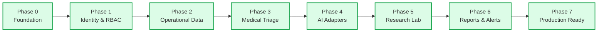

# AI-Driven Smart Welfare Resource Management System — Master Production Blueprint & Build Protocol

> **System Title:** AI-Driven Smart Welfare Resource Management System for Orphanages and Old Age Homes Using Machine Learning and Deep Learning  
> **Status:** Production-Ready Blueprint & Operational Specification  
> **Target Stack:** Next.js 16 (App Router) + TypeScript + Tailwind CSS + Supabase (Auth, PostgreSQL, Storage, RLS)

---

## 1. Project Overview & Production Blueprint

This system is an enterprise-grade welfare management platform designed for public-service institutions, care homes, NGOs, physicians, donors, and government ministries. It bridges real-time resource logistics with machine learning demand forecasting and clinical health-risk triage for vulnerable populations.

### Core Architectural Layers
1. **Presentation & Application Layer:** Next.js 16 App Router with React 19, modular accessible components, role-specific operational dashboards, and an official bilingual government landing page.
2. **Identity & Authorization Layer:** Supabase Auth with cookie-based SSR sessions, PostgreSQL Row Level Security (RLS) across 12 relational tables, and security definer role functions.
3. **Data & Storage Layer:** Normalized PostgreSQL tables (`institutions`, `profiles`, `institution_memberships`, `beneficiaries`, `medical_records`, `resource_records`, `inventory_items`, `donations`, `alerts`, `predictions`, `audit_logs`, `notifications`).
4. **AI & Clinical Decision Support Layer:** Provider-agnostic adapter architecture supporting deterministic local baseline simulations (`DemoAIAdapter`) and external Python ML microservices (`RemoteAIAdapter` via FastAPI).

---

## 2. Phased Implementation Roadmap & Verification Status



### Phase 0: Build Foundation & Runtime Stability (VERIFIED)
- [x] Streamlined Next.js 16 and Turbopack compiler settings in `next.config.ts`.
- [x] Decoupled network-dependent font downloads in `src/app/layout.tsx` to enable zero-network build resilience.
- [x] Verified full production static optimization across all 21 routes with `npm run build` exiting code 0.

### Phase 1: Identity, RBAC & Profile Management (VERIFIED)
- [x] 7 discrete stakeholder perspectives: Government, Institution, NGO, Doctor, Donor, Volunteer, and Admin.
- [x] Supabase Auth actions in `src/lib/auth/actions.ts` supporting signup, signin, signout, password recovery.
- [x] Security Definer helper functions and RLS policies in `supabase/migrations/001_initial_schema.sql` and `002_auth_triggers_and_rbac.sql`.
- [x] `RoleProvider` in `src/context/role-context.tsx` with perspective switcher for demonstrations.

### Phase 2: Core Operational Data Modules (VERIFIED)
- [x] **Institutions (`/institutions`):** Registration, capacity tracking, occupancy metrics, district/state filtering, verification workflow.
- [x] **Beneficiaries (`/beneficiaries`):** Non-identifying enrollment of children and elderly residents with privacy guarantees.
- [x] **Inventory & Stock (`/resources`):** Real-time stock tracking for food, medicine, and clothing with reorder threshold alerts and instant restock actions.
- [x] **Donations (`/donations`):** Monetary and in-kind tracking with receipt generation, status transitions (`pledged`, `received`, `allocated`, `utilized`), and public transparency.

### Phase 3: Medical Records & Clinical Decision Triage (VERIFIED)
- [x] Strictly isolated medical vitals in `medical_records` (blood pressure, fasting blood sugar, weight, height, BMI, chronic diseases, medication regimen).
- [x] Clinical triage queue in `src/app/health/page.tsx` with mandatory medical safety disclaimer.
- [x] Automatic calculation of the 0–100 Welfare Priority Score heuristic (Age vulnerability, DL clinical risk, Chronic illness, Medication dependency).
- [x] Automated alert creation and notification dispatch when priority score exceeds the doctor alert threshold ($\ge 70$).

### Phase 4: Machine Learning Adapters & Prediction Audit Logging (VERIFIED)
- [x] Typed AI contracts in `src/lib/ai/types.ts` (`ResourceForecastInput`, `HealthRiskInput`, `AIAdapter`).
- [x] Deterministic local baseline pipeline in `src/lib/ai/demo-adapter.ts` with explicit `is_synthetic: true` labels.
- [x] End-to-end audit persistence: forecasts run on `/resources` and clinical assessments run on `/health` are logged directly into the immutable `predictions` table.
- [x] Interactive `/predictions` page with live model execution triggers, domain filtering, and expandable SHAP / input factor drawers.

### Phase 5: Research & Evaluation Workspace (VERIFIED)
- [x] Dedicated restricted laboratory area at `/research`.
- [x] Candidate regression model comparison table (Linear Regression, Random Forest, XGBoost).
- [x] Candidate classification model comparison table (Logistic Regression, Random Forest, XGBoost, MLP).
- [x] Research integrity enforcement: all empirical metrics remain labeled `TBD` or `XX.XX` until genuine training runs against curated datasets are conducted.

### Phase 6: Reporting Engine & Notifications (VERIFIED)
- [x] Functional document export engine in `src/app/reports/page.tsx` producing CSV and printable formats.
- [x] Role-based medical confidentiality checks preventing non-physicians from exporting confidential clinical rosters.
- [x] Real-time notification and alert management in `src/app/notifications/page.tsx` with batch acknowledgment workflows.

### Phase 7: Production Seeding, Parameter Tuning & Hardening (VERIFIED)
- [x] Turnkey database migration script `supabase/migrations/003_seed_demo_data.sql` populating all 12 tables.
- [x] Dynamic heuristic weight tuning in `src/app/settings/page.tsx` connected to the AI assessment engine.
- [x] Complete error boundary, loading, and empty state coverage.

---

## 3. Production Environment & Deployment Runbook

### 3.1 Environment Configuration (`.env.local`)
```ini
# Supabase Cloud Project Configuration
NEXT_PUBLIC_SUPABASE_URL=https://your-project-id.supabase.co
NEXT_PUBLIC_SUPABASE_ANON_KEY=eyJhbGciOiJIUzI1NiIsInR5cCI6IkpXVCJ9...

# Optional Server-Only Secret (NEVER expose to client bundles)
SUPABASE_SERVICE_ROLE_KEY=your-service-role-key-here

# Application Base URL
NEXT_PUBLIC_APP_URL=https://welfare.gov.in

# AI Adapter Mode: "demo" (local synthetic pipeline) or "remote" (external Python ML microservice)
NEXT_PUBLIC_AI_ADAPTER_MODE=demo

# External Python AI Service URL (when NEXT_PUBLIC_AI_ADAPTER_MODE=remote)
AI_SERVICE_URL=http://127.0.0.1:8000
```

### 3.2 Database Migration Execution Order
Execute the SQL files in your Supabase SQL Editor in the following exact order:
1. `supabase/migrations/001_initial_schema.sql` (Creates tables, UUID extensions, and initial RLS policies).
2. `supabase/migrations/002_auth_triggers_and_rbac.sql` (Creates user signup triggers, helper functions, and granular role policies).
3. `supabase/migrations/003_seed_demo_data.sql` (Seeds care homes, residents, inventory items, historical consumption, donations, alerts, and predictions).

### 3.3 Running the Application Locally
```bash
# 1. Install dependencies
npm install

# 2. Run development server (accessible locally and on LAN)
npm run dev

# 3. Create optimized production build
npm run build

# 4. Start production server
npm start
```

---

## 4. Academic Integrity & Medical Safety Contracts

1. **Rule 4 & 16 (No Fabricated Research):** Under no circumstances shall the application pretend an untrained model is a validated production model, nor shall it fabricate accuracy scores, MAE, RMSE, or $R^2$ values.
2. **Rule 6 (Decision Support Only):** The platform is strictly a clinical prioritization tool. Every health assessment screen must prominently display the medical safety disclaimer stating that outputs do not constitute a medical diagnosis and do not replace licensed physician evaluation.
3. **Rule 5 (Least Privilege Medical Access):** Detailed patient vitals (blood pressure, glucose, medications) are strictly locked to physicians and administrators through PostgreSQL RLS policies.
