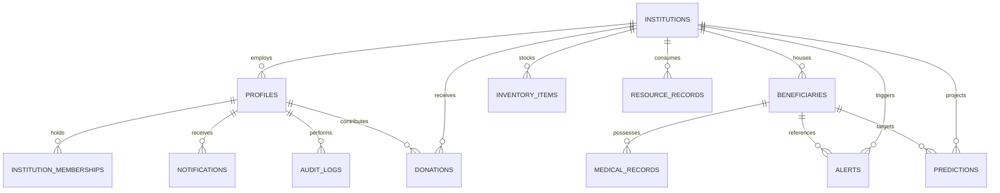

# DATABASE SCHEMA: AI-DRIVEN SMART WELFARE RESOURCE MANAGEMENT SYSTEM

**Database Engine:** PostgreSQL 15+ (Hosted via Supabase)  
**Security Model:** Full Row Level Security (RLS) with Security Definer Helper Functions  
**Migration Order:** `001_initial_schema.sql` -> `002_auth_triggers_and_rbac.sql` -> `003_seed_demo_data.sql`  

---

## 1. Entity-Relationship Model (ERD)



---

## 2. Table Specifications (12 Normalized Tables)

### 2.1 `institutions`
Stores certified care facilities (orphanages, old age homes, and mixed facilities).
- `id` (uuid, PK, default `gen_random_uuid()`)
- `name` (text, not null)
- `institution_type` (text, check `institution_type in ('orphanage', 'old_age_home', 'mixed')`)
- `registration_number` (text, unique, not null)
- `address`, `city`, `state`, `pincode` (text, not null)
- `contact_email`, `contact_phone` (text, not null)
- `capacity` (integer, default 0, check `>= 0`)
- `current_occupancy` (integer, default 0, check `>= 0`)
- `verification_status` (text, check `in ('pending', 'verified', 'rejected')`, default `'pending'`)
- `created_at`, `updated_at` (timestamptz, default `now()`)

### 2.2 `profiles`
User metadata extending Supabase `auth.users`.
- `id` (uuid, PK, references `auth.users(id)` on delete cascade)
- `email` (text, not null)
- `full_name` (text, not null)
- `role` (text, check `role in ('government', 'ngo', 'institution', 'doctor', 'donor', 'volunteer', 'admin')`)
- `phone` (text)
- `institution_id` (uuid, references `institutions(id)` on delete set null)
- `verification_status` (text, check `in ('pending', 'verified', 'rejected')`, default `'verified'`)
- `created_at`, `updated_at` (timestamptz, default `now()`)

### 2.3 `institution_memberships`
Many-to-many role bindings for physicians and NGO staff serving multiple facilities.
- `id` (uuid, PK, default `gen_random_uuid()`)
- `user_id` (uuid, references `profiles(id)` on delete cascade)
- `institution_id` (uuid, references `institutions(id)` on delete cascade)
- `membership_role` (text, default `'assigned'`)
- `created_at` (timestamptz, default `now()`)
- Unique constraint: `(user_id, institution_id)`

### 2.4 `beneficiaries`
Privacy-preserving resident registry.
- `id` (uuid, PK, default `gen_random_uuid()`)
- `institution_id` (uuid, references `institutions(id)` on delete cascade)
- `beneficiary_type` (text, check `in ('child', 'elderly')`)
- `identifier_code` (text, unique, not null, e.g. `BEN-CH-2024-001`)
- `first_name` (text, not null)
- `gender` (text, check `in ('male', 'female', 'other')`)
- `age` (integer, check `age >= 0 and age <= 130`)
- `admission_date` (date, not null default `current_date`)
- `status` (text, check `in ('active', 'transferred', 'discharged')`, default `'active'`)
- `created_at`, `updated_at` (timestamptz, default `now()`)

### 2.5 `medical_records` (Strict Clinical Confidentiality Vault)
Sensitive clinical vitals restricted exclusively to doctors and admins.
- `id` (uuid, PK, default `gen_random_uuid()`)
- `beneficiary_id` (uuid, references `beneficiaries(id)` on delete cascade)
- `doctor_id` (uuid, references `profiles(id)` on delete set null)
- `examination_date` (timestamptz, not null default `now()`)
- `systolic_bp` (numeric, e.g., 120.0)
- `diastolic_bp` (numeric, e.g., 80.0)
- `blood_sugar_fasting` (numeric, mg/dL)
- `bmi` (numeric)
- `chronic_conditions` (text[], default `array[]::text[]`)
- `prescribed_medications` (text[], default `array[]::text[]`)
- `mobility_score` (integer, check `mobility_score between 1 and 5`)
- `clinical_notes` (text)
- `created_at` (timestamptz, default `now()`)

### 2.6 `resource_records`
Historical resource consumption logs used for AI regression training.
- `id` (uuid, PK, default `gen_random_uuid()`)
- `institution_id` (uuid, references `institutions(id)` on delete cascade)
- `record_date` (date, not null)
- `food_consumed_kg` (numeric, default 0)
- `clothes_distributed` (integer, default 0)
- `medicines_dispensed` (integer, default 0)
- `operational_expense_inr` (numeric, default 0)
- `resident_count_snapshot` (integer, not null)
- `created_at` (timestamptz, default `now()`)

### 2.7 `inventory_items`
Real-time stock counts and replenishment thresholds.
- `id` (uuid, PK, default `gen_random_uuid()`)
- `institution_id` (uuid, references `institutions(id)` on delete cascade)
- `category` (text, check `in ('food', 'clothing', 'medicine', 'hygiene', 'bedding', 'other')`)
- `item_name` (text, not null)
- `quantity` (numeric, not null check `quantity >= 0`)
- `unit` (text, not null, e.g., 'kg', 'units', 'liters')
- `minimum_threshold` (numeric, not null default 10)
- `expiry_date` (date)
- `created_at`, `updated_at` (timestamptz, default `now()`)

### 2.8 `donations`
Monetary contributions and in-kind provisions.
- `id` (uuid, PK, default `gen_random_uuid()`)
- `donor_id` (uuid, references `profiles(id)` on delete set null)
- `institution_id` (uuid, references `institutions(id)` on delete cascade)
- `donation_type` (text, check `in ('monetary', 'in_kind')`)
- `amount_inr` (numeric, check `amount_inr >= 0`)
- `category` (text, not null)
- `quantity` (numeric)
- `unit` (text)
- `receipt_number` (text, unique, not null)
- `is_anonymous` (boolean, default false)
- `status` (text, check `in ('pledged', 'received', 'allocated', 'utilized')`, default `'pledged'`)
- `allocated_purpose` (text)
- `created_at`, `updated_at` (timestamptz, default `now()`)

### 2.9 `alerts`
System, inventory, and clinical triage warnings.
- `id` (uuid, PK, default `gen_random_uuid()`)
- `institution_id` (uuid, references `institutions(id)` on delete cascade)
- `beneficiary_id` (uuid, references `beneficiaries(id)` on delete set null)
- `alert_type` (text, check `in ('inventory_low', 'health_risk', 'capacity_limit', 'donation_received', 'verification_pending')`)
- `severity` (text, check `in ('low', 'medium', 'high', 'critical')`)
- `title` (text, not null)
- `description` (text, not null)
- `priority_score` (numeric, e.g., 78.5 for clinical alerts)
- `status` (text, check `in ('pending_review', 'acknowledged', 'resolved')`, default `'pending_review'`)
- `created_at` (timestamptz, default `now()`)

### 2.10 `predictions`
Audit trail of all executed AI inferences.
- `id` (uuid, PK, default `gen_random_uuid()`)
- `institution_id` (uuid, references `institutions(id)` on delete cascade)
- `beneficiary_id` (uuid, references `beneficiaries(id)` on delete set null)
- `prediction_type` (text, check `in ('resource_demand', 'health_risk', 'priority_score')`)
- `target_variable` (text, not null)
- `predicted_value` (numeric)
- `predicted_class` (text)
- `model_name` (text, not null)
- `model_version` (text, not null)
- `model_tier` (text, check `in ('demo', 'candidate_heuristic', 'trained_production')`)
- `confidence_score` (numeric)
- `input_features_snapshot` (jsonb, not null)
- `factors_snapshot` (jsonb)
- `is_synthetic` (boolean, not null default true)
- `created_at` (timestamptz, default `now()`)

### 2.11 `audit_logs`
Immutable regulatory logging for all mutating system actions.
- `id` (uuid, PK, default `gen_random_uuid()`)
- `user_id` (uuid, references `profiles(id)` on delete set null)
- `institution_id` (uuid, references `institutions(id)` on delete set null)
- `action` (text, not null)
- `entity_type` (text, not null)
- `entity_id` (text, not null)
- `changes` (jsonb)
- `ip_address` (text)
- `created_at` (timestamptz, default `now()`)

### 2.12 `notifications`
Direct recipient alerts for individual users.
- `id` (uuid, PK, default `gen_random_uuid()`)
- `user_id` (uuid, references `profiles(id)` on delete cascade)
- `title` (text, not null)
- `message` (text, not null)
- `link_url` (text)
- `is_read` (boolean, default false)
- `created_at` (timestamptz, default `now()`)

---

## 3. High-Performance Indexing Strategy

```sql
create index if not exists idx_beneficiaries_inst on public.beneficiaries(institution_id);
create index if not exists idx_medical_records_ben on public.medical_records(beneficiary_id);
create index if not exists idx_inventory_items_inst on public.inventory_items(institution_id, category);
create index if not exists idx_resource_records_inst on public.resource_records(institution_id, record_date);
create index if not exists idx_alerts_status on public.alerts(status, severity);
create index if not exists idx_donations_status on public.donations(institution_id, status);
create index if not exists idx_predictions_inst on public.predictions(institution_id, prediction_type);
create index if not exists idx_notifications_user on public.notifications(user_id, is_read);
```
