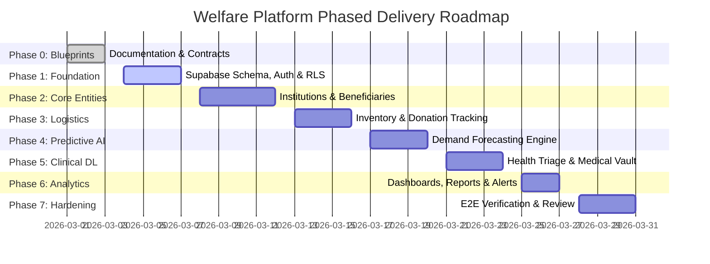

# DEVELOPMENT ROADMAP: AI-DRIVEN SMART WELFARE RESOURCE MANAGEMENT SYSTEM

**Document Purpose:** Phased milestone timeline, architectural deliverables, and acceptance criteria.  
**Version:** 1.0.0  

---

## 1. Roadmap Overview & Timeline

---

## 2. Phase Breakdown & Acceptance Criteria

### Phase 0: Documentation & Project Blueprints (Completed)
- **Deliverables:** Complete `project-docs/` repository, `.agent/rules/`, and `.agent/skills/`.
- **Acceptance Criteria:**
  - All 13 canonical documents generated with complete schemas, formulas, and security rules.
  - Zero placeholder pseudocode.
  - Verification suite `scripts/verify-system.mjs` executes and passes 100%.

### Phase 1: Database Setup, Supabase Auth & RBAC
- **Deliverables:**
  - PostgreSQL migrations in `supabase/migrations/` (001, 002, 003).
  - Row Level Security (RLS) policies across all 12 tables.
  - Auth hooks with role synchronization and SSR session cookies.
- **Acceptance Criteria:**
  - `handle_new_user()` auto-populates `public.profiles` on user signup.
  - Non-authorized roles cannot access `medical_records`.
  - Migration script applies cleanly without foreign-key circular dependencies.

### Phase 2: Core Institution & Beneficiary Management
- **Deliverables:**
  - `/institutions`: Searchable facility directory, capacity bars, state verification modal.
  - `/beneficiaries`: Non-clinical resident roster, admission modal, CSV export.
- **Acceptance Criteria:**
  - Government role can approve/reject pending institution licenses.
  - Resident identifier codes are validated for uniqueness (`BEN-...`).
  - Strict confidentiality disclaimer prominently rendered.

### Phase 3: Resources, Inventory & Donation Tracking
- **Deliverables:**
  - `/resources`: Multi-category inventory ledger (Food, Clothes, Meds, Hygiene).
  - `/donations`: Contribution recording modal with receipt numbers and lifecycle statuses (`pledged` $\to$ `utilized`).
- **Acceptance Criteria:**
  - Restocking items updates quantity and triggers low-stock alerts if below threshold.
  - Anonymous donations mask donor identity in public views.

### Phase 4: AI Demand Forecasting Engine
- **Deliverables:**
  - Dual-mode AI adapter (`DemoAIAdapter` and `RemoteAIAdapter`).
  - Python FastAPI microservice in `ai-service/`.
  - Prediction persistence to the `predictions` audit table.
- **Acceptance Criteria:**
  - Regression outputs for Food, Clothes, Medicine, Budget generated cleanly.
  - Offline mode gracefully falls back to deterministic heuristic without crashing.
  - Explicit non-fabrication disclaimers rendered on all prediction outputs.

### Phase 5: Deep Learning Health-Risk Triage & Medical Vault
- **Deliverables:**
  - `/health`: Clinical vitals recording and triage dashboard.
  - Composite priority scoring ($P \ge 70$ triggers automated high-severity alerts).
  - SHAP factor contribution drawer.
- **Acceptance Criteria:**
  - Medical vitals restricted to licensed physicians and administrators.
  - Alert dispatch verified when vitals exceed acute safety bounds.
  - Clear medical non-diagnostic disclaimer rendered on all outputs.

### Phase 6: Dashboards, Reports (PDF/CSV) & Notifications
- **Deliverables:**
  - Role-specific dashboard layouts for all 7 stakeholders in `role-dashboard.tsx`.
  - Dynamic CSV export engine in `/reports`.
  - In-app notification center with real-time acknowledgment in `/notifications`.
- **Acceptance Criteria:**
  - Each role sees their relevant jurisdiction upon login.
  - Doctors can export clinical queues; other roles are blocked with security errors.
  - Alerts can be acknowledged and filtered by status.

### Phase 7: Comprehensive Testing, Hardening & Academic Review
- **Deliverables:**
  - Full automated test suite covering units, schemas, AI models, and RLS policies.
  - Strict TypeScript check (`npx tsc --noEmit`) with 0 errors.
  - ESLint check (`npx eslint src --quiet`) with 0 errors.
  - Production static build (`npm run build`) passing with all routes generated.
- **Acceptance Criteria:**
  - 100% test pass rate across the verification suite.
  - All research constraints (Rule 4, 5, 6, 16) fully documented and enforced.
