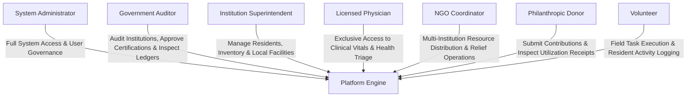

# MASTER BLUEPRINT: AI-DRIVEN SMART WELFARE RESOURCE MANAGEMENT SYSTEM

**Project Title:** AI-Driven Smart Welfare Resource Management System for Orphanages and Old Age Homes Using Machine Learning and Deep Learning  
**Domain:** Social Welfare, Orphanage & Geriatric Care Management, Applied Machine Learning, Healthcare Decision Support  
**Target Academic Level:** Master of Computer Applications (MCA) Capstone / Applied Research  
**Document Version:** 1.0.0  
**Status:** Approved Architecture & Implementation Standard  

---

## 1. Executive Summary & Mission Statement

Welfare institutions—specifically orphanages and old age homes—face systemic inefficiencies in inventory distribution, seasonal resource forecasting, donor transparency, and early identification of resident health deteriorations. Administrative personnel frequently rely on fragmented paper logbooks or siloed spreadsheets, resulting in stockouts of essential pediatric medicines, perishable food waste, and delayed clinical interventions for vulnerable senior residents.

This platform provides a unified, government-grade social welfare resource management and decision-support ecosystem. It connects 7 distinct societal stakeholders:
1. **Government Social Welfare Departments:** Regulatory compliance, regional auditing, and subsidy allocations.
2. **Institution Superintendents:** Day-to-day resident admissions, inventory logistics, and health tracking.
3. **Non-Governmental Organizations (NGOs):** Cross-institutional support and community resource distribution.
4. **Licensed Physicians & Healthcare Providers:** Clinical triage, physiological monitoring, and decision support.
5. **Philanthropic Donors:** Direct monetary/in-kind contributions with tamper-evident audit receipts.
6. **Community Volunteers:** Field task fulfillment, tutoring, and recreational service logging.
7. **System Administrators:** Infrastructure health, identity lifecycle management, and audit verification.

---

## 2. Core Research Hypotheses & Academic Objectives

### Research Hypothesis 1 (Resource Optimization)
By modeling historical monthly consumption, resident demographics (children vs. elderly ratios), seasonal variations (winter, summer, monsoon), and regional festive cycles through multivariate regression (Linear Regression, Random Forest, XGBoost), the system can forecast resource deficits with a targeted Mean Absolute Error (MAE) significantly lower than manual baseline estimations.

### Research Hypothesis 2 (Clinical Decision Support)
By evaluating vital signs (blood pressure, fasting blood sugar, BMI), chronic ailment history, and medication dependency using a Deep Learning Multilayer Perceptron (MLP) alongside a weighted priority scoring index, healthcare staff can prioritize residents at highest acute risk without violating clinical autonomy.

### Strict Academic Integrity Boundary (Rule 4 & Rule 16)
In strict compliance with empirical research standards:
- **No metrics are fabricated.** Unexecuted model architectures are marked as `TBD` or `XX.XX` until real empirical training runs occur.
- **Decision Support Only (Rule 6):** Machine learning triage outputs are advisory clinical heuristics. They do not constitute a formal diagnostic claim or medical prescription.

---

## 3. Mandatory Technology Architecture

| Tier | Technology | Specification / Standard |
|---|---|---|
| **Frontend Framework** | Next.js 16 (App Router) | React 19, Strict TypeScript, Server/Client components |
| **Styling & Design System** | Tailwind CSS v4 + shadcn/ui | Radix UI primitives, accessible Lucide icons, Dark/Light modes |
| **Authentication & RBAC** | Supabase Auth + SSR | `@supabase/ssr`, HTTP-only cookie JWTs, role metadata |
| **Database & Storage** | PostgreSQL 15+ (Supabase) | 12 normalized tables, Row Level Security (RLS) on all tables |
| **AI/ML Microservice** | Python 3.10+ / FastAPI | Uvicorn ASGI server, Pydantic v2 validation contracts |
| **Machine Learning** | Scikit-learn, XGBoost | Multivariate regression & Multiclass classification |
| **Explainability** | SHAP (Shapley Additive exPlanations) | TreeExplainer & DeepExplainer feature contribution breakdown |
| **Analytics & Visualization** | Recharts | Composable SVG time-series, bar distributions, radar charts |
| **Reporting Engine** | Dynamic CSV & @react-pdf/renderer | Tamper-evident receipts, safe non-clinical rosters, clinical audits |

---

## 4. Architectural Domain Modules (15 Core Modules)

1. **Government Landing Website (`/`):** Public portal showcasing transparency metrics, institution locator, mission directives, and login gateways.
2. **Authentication & RBAC (`/(auth)/*`):** Secure signup, login, session recovery, and role redirection for all 7 user roles.
3. **Institution Management (`/institutions`):** Registration, capacity tracking, bed occupancy rates, and government state verification workflows.
4. **Beneficiary Management (`/beneficiaries`):** Privacy-preserving registry of children and senior citizens with institutional assignment.
5. **Resource & Inventory Management (`/resources`):** Food provisions, clothing kits, essential pharmaceuticals, and emergency buffer levels.
6. **Donation Management (`/donations`):** Monetary pledges, in-kind supplies, automated receipt generation, and utilization lifecycle tracking.
7. **Medical Records & Health Vault (`/health`):** Doctor-isolated clinical records, vital signs history, and priority triage queue.
8. **AI Resource Demand Forecasting (`/resources`):** Forward-looking predictive models for upcoming quarterly procurement budgets.
9. **Deep Learning Health-Risk Decision Support (`/health`):** Algorithmic risk scoring with automatic critical alert dispatch ($\text{Score} \ge 70$).
10. **AI Predictions & Explainability (`/predictions`):** Interactive simulations, SHAP factor attribution drawers, and prediction audit logs.
11. **Research & Model Evaluation Laboratory (`/research`):** Controlled laboratory area for dataset validation and benchmark comparison.
12. **Reports & Data Export (`/reports`):** Dynamic CSV export engine with strict role-based data isolation.
13. **Alerts & In-App Notifications (`/notifications`):** Real-time warnings for stockouts, capacity bottlenecks, and acute patient triage.
14. **User & System Settings (`/settings`):** Customizable priority weights (Age, ML Risk, Chronic Illness, Medication Dependency).
15. **Audit Logging & Security Verification (`/reports` & PostgreSQL):** Immutable audit trails capturing timestamp, actor, action, and target record.

---

## 5. Seven User Roles & High-Level Permissions

---

## 6. Phased Delivery Roadmap Summary

- **Phase 0:** Project Architecture, Documentation & Master Blueprint (Active)
- **Phase 1:** Supabase Database Schema, Authentication Triggers & RLS Policies
- **Phase 2:** Core Institutional Registry & Beneficiary Admission Modules
- **Phase 3:** Resource Tracking, Inventory Restocking & Donation Lifecycle
- **Phase 4:** AI Demand Forecasting Engine (Dual-Mode Demo & FastAPI Microservice)
- **Phase 5:** Deep Learning Clinical Health-Risk Triage & Medical Records Vault
- **Phase 6:** Specialized Dashboards, Reporting Engine (CSV/Print) & Notifications
- **Phase 7:** End-to-End System Verification, Performance Audits & Academic Review
