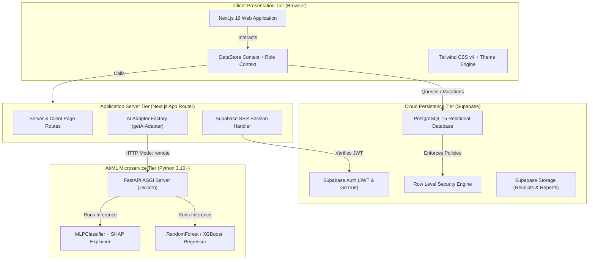
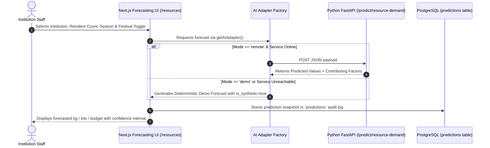
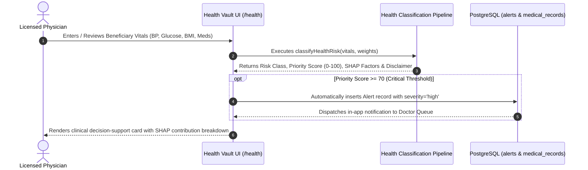
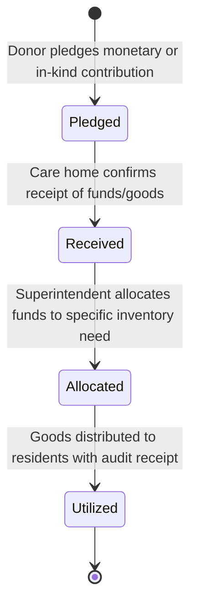

# SYSTEM ARCHITECTURE: AI-DRIVEN SMART WELFARE RESOURCE MANAGEMENT SYSTEM

**Document Purpose:** Detailed technical architecture specification, component interaction flows, and system topologies.  
**Version:** 1.0.0  

---

## 1. High-Level Architectural Topology

---

## 2. Key Data Workflows

### 2.1 AI Resource Demand Forecasting Workflow

### 2.2 Deep Learning Health-Risk Triage Workflow

### 2.3 Transparent Donation Lifecycle

---

## 3. Resilience, Fault Tolerance & Offline Mode

1. **Dual-Mode Adapter Fallback:** The web app never crashes if the Python AI microservice is offline or experiencing network latency. `RemoteAIAdapter` wraps all HTTP calls in a `try...catch` block with a 5000ms timeout, automatically delegating to `DemoAIAdapter` upon network failure.
2. **Local Client Fallback for Development:** When Supabase environment variables are missing or unconfigured, the application runs cleanly using synthetic in-memory demo datasets, allowing developers to review every UI screen and workflow without blocking on cloud credentials.
3. **Zero External Font / Asset Hard-Dependencies:** System fonts (`system-ui, -apple-system, BlinkMacSystemFont, "Segoe UI", Roboto`) are utilized natively in CSS to ensure offline compiling and sandboxed security compliance.
